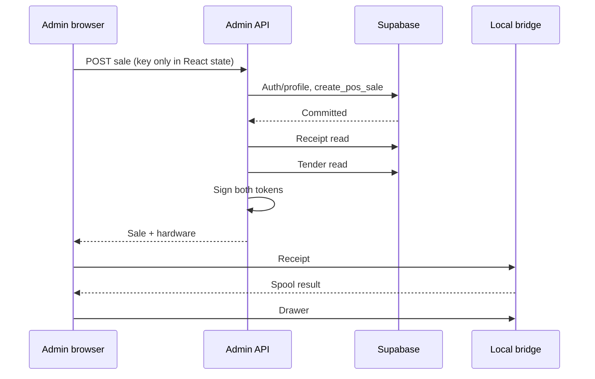

# Admin POS Phase 2A/2B — implementation and rollout

Scope: walk-in Admin POS only. No storefront changes, offline sale completion, automatic offline sale synchronization, split payments, deployment or production migrations.

## Implemented behavior

- Cash sales still require cloud confirmation. The new service-only `create_pos_sale_with_receipt` wrapper invokes the existing `create_pos_sale` inside the same transaction, then returns the canonical committed order/tender/items. Sale creation, paid status, stock reservation/movements, tender and request binding remain atomic. The two post-commit HTTP reads are removed. Historical migrations are unchanged.
- The browser persists the request UUID and immutable submission payload in IndexedDB BEFORE any POST. The six explicit states are prepared, submitting, committed, rejected, outcome_unknown and needs_review.
- A synchronous in-tab guard plus a Web Lock per cashier prevents competing submissions across tabs. The active record is checked again inside the lock. Basket and payment controls are locked for an active attempt. Current Chromium/Web Locks is required; storage/locking failure disables new submissions.
- Timeout, interrupted submission and connection loss preserve the original identity. Staff explicitly check an authorized, cashier-owned GET outcome endpoint. A missing row does not prove failure; staff may retry ONLY the preserved key/payload. Recovery never starts a replacement sale or automatically dispatches hardware.
- Cash drawer request is awaited FIRST, including its bounded failure/timeout result; only then is receipt submission invoked in a finally block. The successful drawer request has already passed through the bridge's shared queue before receipt dispatch. No concurrent requests are used to guess ordering.
- Hardware results are independent of committed transaction state. pending actions interrupted by restart become outcome_unknown. The UI describes Windows submission, never physical printing/drawer movement.
- A receipt-only reprint uses a separate explicit print action UUID against the existing committed sale. It never invokes sale posting, stock reservation or drawer authorization.
- Receipt and drawer JWTs retain the 60-second lifetime. Initial scopes are returned with the confirmed sale to avoid another cloud round trip. They are never persisted. An aged initial grant is refreshed just before dispatch; recovered actions and reprints always get fresh scope. Refreshing a token retains the original stable drawer action identity.
- The local bridge has additive /pos routes and a durable per-action ledger. A durable exclusive claim (flushed before submission) suppresses repeated commands across process restarts. A pending/corrupt/uncertain record fails closed. Ambiguous drawer operations have status lookup only; no automatic or UI drawer replay is provided. Definite pre-spool cooldown/configuration rejection is recorded separately from an uncertain spool outcome.
- Existing receipt formatting, feed/cut, Windows RAW queue, origin checks, shared six-per-minute drawer limiter and hardware cooldown remain. New scoped tokens are rejected by legacy hardware endpoints to prevent bypassing the durable ledger. Unrelated existing hardware routes are retained for compatibility.
- Stage timings use monotonic clocks. Correlation is the request UUID in Admin and the stable pos:orderId:kind:requestId in the bridge. API hardware authorization also carries the request correlation ID. No JWT, reference, customer data or receipt body is logged or persisted in the new bridge ledger.

## Before



## After

```mermaid
sequenceDiagram
  participant UI as Admin browser
  participant IDB as IndexedDB / Web Lock
  participant API as Admin API
  participant DB as Supabase
  participant B as Local bridge
  participant L as Durable action ledger
  UI->>IDB: Persist UUID + immutable payload; submitting
  UI->>API: POST original identity
  API->>DB: Auth/profile; create_pos_sale_with_receipt
  Note over DB: Existing atomic sale RPC + canonical receipt
  DB-->>API: Committed sale and receipt
  API->>API: Sign stable short-lived cash hardware scopes
  API-->>UI: Sale confirmed + response-only hardware grants
  UI->>IDB: Persist committed (no tokens)
  UI->>B: /pos/drawer/open
  B->>L: Flush exclusive action claim
  B->>B: Authorised shared queue -> Windows RAW pulse
  B->>L: Persist submitted (or uncertain)
  B-->>UI: Windows submission acknowledgement / error
  opt Receipt grant aged or recovered
    UI->>API: Fresh receipt-only authorization
    API-->>UI: Same-action short-lived token
  end
  UI->>B: /pos/receipt/print (even if drawer failed)
  B->>L: Flush exclusive print claim
  B->>B: Existing ESC/POS receipt -> shared RAW queue
  B-->>UI: Independent submission result
  UI->>IDB: Persist hardware results independently
```

Physical output can still be delayed by previously executing jobs, printer/spooler transport or device processing. If an HTTP deadline expires, a server operation may continue. Drawer-first request dispatch is deterministic; physical completion/order after an ambiguous timeout is not asserted.

## Recovery and operating instructions

- On “outcome unknown,” keep the original attempt. Reconnect/sign in as the original cashier and select **Check original sale outcome**.
- A confirmed match restores the receipt without replaying hardware. If absent, **Retry preserved request** uses the same immutable identity. It is not an automatic background synchronization system.
- Unresolved attempts cannot be dismissed as a new sale. If ownership/connection cannot be verified, staff review is required.
- **Check hardware status (no replay)** reads the original bridge's durable record. It does not print or pulse. Use the original POS PC; “no record” on another machine does not prove the action never ran.
- **Reprint recorded receipt only** creates a distinct, explicitly requested print action. A prior uncertain print warns that a physical receipt may already exist.
- There is intentionally no “retry uncertain drawer” button. Staff must inspect the drawer/Windows queue and resolve the incident through a supervised process.
- “Start next sale” closes only a committed/rejected attempt's active pointer; recorded receipts remain locally reviewable. Hardware processing holds that cashier's coordination lock until its bounded requests settle; other terminals/cashiers are not locked by this browser lock.
- IndexedDB stores only required sale fields and committed receipt data. No bearer token or payment credential is stored. Terminal references are retained as part of the exact retry payload; protect the staff browser profile and do not clear its data during unresolved attempts.
- Browser persistence is local to this origin/profile, not a backup or cross-device ledger. Private mode, browser-data deletion, storage eviction and hardware disk loss remain limitations. Sign out does not move pending work to another browser.

## Rollout order and readiness

1. The user confirmed v0.2.1 is installed on the POS PC and exposes walk_in_pos_actions_v1 (2026-10-29). For a fresh rollout, back up the original bridge data and build/install the updated Windows bridge first. Retain its data directory across every update/restart; do not run multiple instances sharing a ledger. Verify its health capability includes walk_in_pos_actions_v1. Do not send test pulses without an operator-controlled hardware check.
2. Phase 100 is confirmed present on the live Smokehouse Supabase project as of 2026-10-29: both function bodies, signatures, SECURITY DEFINER/search_path settings and role grants match this migration. Verification was read-only. For a fresh environment, apply **db/phase-100-pos-sale-recovery-receipt.sql** to the intended Supabase environment. It creates two service-only functions and keeps the old sale RPC intact. Verify the new grants and canonical receipt against a staging transaction, including same-key replay and stock/tender counts.
3. Deploy the Admin changes after bridge and database readiness. Old bridges return 404 for new routes; Admin does not fall back to an unsafe legacy drawer command.
4. Run the terminal checklist below before restoring normal operation. Do not clear the bridge's data/pos-actions-v1 directory to “fix” uncertainty.
5. Rolling back Admin to legacy behavior also removes its durable action scope. Avoid mixing old/new Admin tabs during rollout or rollback; supervise cash sales during that window.

No new environment variables or dependencies are required. POS_TEST_CHROME optionally selects Chrome for the isolated browser test only. Existing bridge origin, printer, signing keys and JWKS configuration remain.

## Validation

Verified local results: 47 Admin tests and 14 bridge tests passed; Admin type-check and production build passed; bridge build passed. Scoped Admin lint reported zero errors and two pre-existing img-element warnings. No sale function was executed against Supabase; read-only catalog verification subsequently confirmed Phase 100 live. No physical output was tested by the agent.

Commands:
- Admin: node --test tests/*.test.mjs
- Admin types: node node_modules/typescript/bin/tsc --noEmit --incremental false
- Admin build: npm run build
- Bridge: npm test; npm run build
- Scoped Admin ESLint uses the existing sibling storefront's installed ESLint/Next flat configs, without modifying that project or installing packages.

The browser test launches a hidden isolated headless Chrome profile and a synthetic localhost origin. It tests actual IndexedDB and Web Locks, including full browser-process restart. It does not load production Admin or any Supabase/hardware endpoint.

The controller/API tests mock network/storage boundaries; bridge HTTP and printer tests replace the OS boundary. Existing SQL tests inspect contracts; they are NOT live database migration/transaction tests. Full deployed accounting/stock verification remains a staging/manual requirement.

## Physical POS verification checklist — NOT executed

- Confirm the original Windows printer, port and allowed Admin origin; preserve the bridge ledger.
- On staging, submit one cash sale. Verify one order, tender, idempotency binding and expected stock movement set. Confirm canonical receipt values/cut are unchanged.
- Observe the drawer request before receipt dispatch. Confirm neither receipt failure nor drawer failure hides the other's status or changes sale commitment.
- Disconnect the printer or mock its failure under supervision; confirm UI wording distinguishes failed/uncertain from submitted.
- Simulate slow network and lost response after commitment. Refresh and reopen; confirm original UUID, recovered order and unchanged tender/stock counts. No hardware should auto-replay.
- Open two POS tabs for the same cashier. Verify competing submission is blocked and original status is restored.
- Verify card/mobile-money staff-recorded sales do not invoke either local hardware action. External electronic authorization remains outside this workflow.
- Explicitly reprint a committed cash receipt. Confirm no new order/tender/stock reservation or drawer pulse.
- Restart the bridge with a prior action ledger. Verify status/deduplication using mocked hardware before an operator-controlled physical test.
- Confirm unknown drawer outcomes require review and are never automatically retried.
- Compare correlated stage timings without exposing tokens, references, receipt contents or personal information.

## Remaining limits

- No offline completed sales, automatic sale synchronization or split payments.
- No exactly-once physical execution claim. Claims plus Windows submission cannot atomically prove drawer movement or paper output; power loss/storage loss remain outside that guarantee.
- New durable protection covers the new walk-in routes. Legacy endpoint compatibility and diagnostic CLI retain their existing operational model.
- Short-lived tokens can still expire during extreme delivery/key-fetch delay; obtain fresh scope without changing action identity. No cached long-lived credential is introduced.
- The agent did not run database migrations or production timing/physical tests. Phase 100 definitions and grants were verified live through read-only catalog queries on 2026-10-29. The new wrapper preserves existing transaction boundaries by delegation; end-to-end stock/tender and physical behavior still require the controlled acceptance test.

## Files changed

Admin:
- app/(admin)/pos/page.tsx — cashier identity for local recovery scoping.
- components/pos/pos-sale-workspace.tsx — locked controls, recovery and hardware status UI.
- app/api/admin/pos/sales/route.ts — atomic receipt wrapper, initial hardware scopes, timings.
- app/api/admin/pos/sales/[idempotencyKey]/route.ts — cashier-owned outcome lookup.
- app/api/admin/pos/sales/[idempotencyKey]/hardware/route.ts — committed-cash action authorization.
- lib/auth/admin-role.ts — optional POS timing callback only; existing access decisions retained.
- lib/pos/hardware-bridge.ts — stable action scope signing.
- lib/pos/{sale-contract,sale-server,attempt-store,use-pos-sale,hardware-client,hardware-dispatch,timing}.ts — recovery, persistence, orchestration and timings.
- db/phase-100-pos-sale-recovery-receipt.sql — new migration only.
- tests/pos-{hardware-order,recovery,storage-browser}.test.mjs and pos-test-loader.mjs — behavior/browser tests.
- package.json — test:pos script; no dependency changes.
- docs/admin-pos-phase-2.md — this implementation and rollout report.

Bridge:
- src/pos-action-store.ts and src/pos-actions-router.ts — new durable walk-in action boundary.
- src/{auth,server,printer,errors}.ts — scoped authorization, shared limits, additive routes and timings.
- scripts/send-raw-printer.ps1 — monotonic spool-duration measurement only.
- tests/pos-actions.test.ts — mocked Windows boundary, auth, queue, limits and restart tests.
- dist/*.js — regenerated by the bridge TypeScript build; install together with source scripts on the POS PC.

## Admin deployment preparation — 2026-10-29

- Revalidated on top of main ec764c7 (the separate soda/carton intake change).
- Updated one stale procurement test assertion to reflect that already-committed quantity/unit wording; no procurement behavior was changed.
- Reran all 47 Admin tests, including the isolated real-browser restart/tab-lock test.
- Updated Admin deployment is authorized by the user. Controlled physical cash-sale/reprint acceptance remains pending after deployment.
